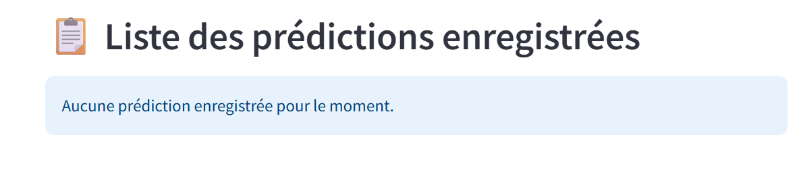

# Ticket d'incident 4

## Étapes pour reproduire le problème
1. A la première utilisation, lorsqu'il n'y a aucune prédiction.
2. Lancer l'application.
3. Ajouter une image satellite du désert sur la page *Upload image*.
4. *Envoyer*
6. Passer sur la page *Voir les prédictions*.
7. La *Liste des prédictions enregistrées* est vide.

## Résultat actuel
Malgré l'ajout d'une première prédiction, la *Liste des prédictions enregistrées* affiche *Aucune prédiction enregistrée pour le moment.*.



## Comportement attendu
La *Liste des prédictions enregistrées* doit afficher la première *prédiction*.

---

# Correction

**Date de la correction : 7 octobre 2026**

### Cause du bug
Dans `api/app/bdd/service.py`, la méthode `lister_predictions` retirait systématiquement la dernière ligne renvoyée par la base de données (table *predictions*)  :

``` python
length = len(rows)-1
return [Prediction(**row) for row in rows[:length]]
```

Avec une seule prédiction, `length` valait 0 et la liste renvoyée était vide. Avec N prédictions, seules N-1 étaient affichées : le bug touchait donc toutes les prédictions, pas uniquement la première.

### Correction apportée
La liste est maintenant construite à partir de toutes les lignes :

``` python
return [Prediction(**row) for row in rows]
```

### Autres modifications
- **Tests unitaires** (`api/tests/`, `pytest`) : tests de non-régression avec une base simulée (`unittest.mock`). Avec le bug, 4 tests échouent ; avec la correction, les 6 passent.
- **Contrôle dans le code** : `lister_predictions` écrit un log (`Liste des prédictions OK : N renvoyée(s)`, ou une erreur en cas d'incohérence) et incrémente le compteur `liste_predictions_incoherences_total` si le nombre de lignes renvoyées diffère du nombre de lignes lues.
- **Monitoring** (Prometheus + Grafana, dossier `monitoring/`) : l'API expose `/metrics` (prédictions par classe, durée d'inférence du modèle, requêtes HTTP par code, durée et erreurs de la base, compteur d'incohérences du ticket 4). 
- **Dashboard Streamlit** : nouvelle page *📊 Dashboard* dans la sidebar, qui lit `/metrics`.

### Résumé des fichiers créés ou modifiés

| Fichier | Modification |
|---|---|
| `api/app/bdd/service.py` | **Correction du bug** (`rows[:length]` devient `rows`), logs et compteur d'incohérences |
| `api/app/main.py` | Exposition de `/metrics`, métriques d'inférence du modèle CNN, configuration des logs |
| `api/app/metrics.py` | *Nouveau* : définition des métriques Prometheus et décorateur `mesurer_bdd` |
| `api/tests/` | *Nouveau* : tests unitaires (`test_service.py`, `conftest.py`) |
| `api/pytest.ini` | *Nouveau* : configuration de pytest |
| `api/requirements.txt` | Ajout de `prometheus-client` et `prometheus-fastapi-instrumentator` |
| `client/app.py` | nouvelle page *Dashboard* |
| `client/metrics_utils.py` | *Nouveau* : lecture et calcul des métriques pour le dashboard |
| `client/config.py` | Ajout de `API_METRICS_URL` |
| `client/Dockerfile` | Copie de `metrics_utils.py` |
| `client/requirements.txt` | Ajout de `prometheus-client` |
| `docker-compose.yml` | Ajout des services `prometheus` et `grafana` |
| `monitoring/` | *Nouveau* : `prometheus.yml` (collecte des métriques), `grafana/datasource.yml` (source Prometheus automatique) et `grafana/dashboards/` (`dashboard.yaml` pour le provisioning, `dashboard_cas_pratique.json` pour le dashboard pré-configuré) |
---
# Cas pratique
Cas pratique sur une application permettant de classifier des images satellites grâce à un modèle CNN

### Compétences visées
- C.20 : Surveiller une application d’intelligence artificielle
- C.21 : Résoudre les incidents techniques

Ces deux compétences sont validées par l'épreuve E5.


## Installation
### Démarrage avec Docker

Depuis la racine du projet, créer votre fichier `.env` en copiant le modèle :
```powershell
cp .env.example .env
```
Aadapter les valeurs et lancer ensuite :

```powershell
docker compose up --build -d
```
| Service | Adresse par défaut |
| --- | --- |
| Client Streamlit | http://localhost:8501 |
| Documentation API | http://localhost:8081/docs |
| Adminer | http://localhost:8080 |
| MySQL | localhost:3306 |
| Prometheus | http://localhost:9090/targets |
| Grafana | http://localhost:3000 |


Dans Adminer, utiliser le serveur `db` et les valeurs `MYSQL_USER`,
`MYSQL_PASSWORD` et `MYSQL_DATABASE` du `.env` pour accéder à la base de données.

```powershell
docker compose logs -f
docker compose down
```

Les données MySQL sont conservées dans `databases/`, et les images reçues dans
`api/satelite_images/`. `data/db/init.sql` est exécuté uniquement lors de la
création d'une base sur un dossier de données vide. Modifier les identifiants
dans `.env` ne modifie pas les comptes d'une base déjà initialisée.

### Configuration

Compose lit automatiquement le `.env` à la racine pour les identifiants et les
ports publiés. Il transmet à chaque application uniquement les variables dont
elle a besoin. Les connexions entre conteneurs utilisent `db:3306` et `web:80`,
indépendamment des ports publiés sur la machine.

Les configurations Python chargent ce même `.env` avec `python-dotenv` pour un
lancement local, sans écraser les variables déjà présentes dans l'environnement.
Les identifiants MySQL n'ont aucune valeur par défaut dans le code Python.
`DB_HOST`, `DB_PORT` et `API_BASE_URL` servent aux connexions locales ; Compose
les remplace par les adresses internes appropriées.

Si `API_PORT` change, adapter aussi `API_BASE_URL` pour le client lancé localement.
`UPLOAD_FOLDER` est relatif au dossier `api/` en local ; Compose fixe son chemin
au dossier persistant monté dans le conteneur.

L'API attend que MySQL soit prêt. Après modification des dépendances, relancer `docker compose up --build -d`.

### Lancement Python local

Avec Python 3.11 et les dépendances installées dans un environnement virtuel,
lancer MySQL et Adminer avec `docker compose up -d db adminer`, puis :

```powershell
cd api
python -m pip install -r requirements.txt
python -m uvicorn app.main:app --host 127.0.0.1 --port 8081
```

Dans un deuxième terminal depuis la racine :

```powershell
cd client
python -m pip install -r requirements.txt
python -m streamlit run app.py
```

Adapter le port Uvicorn si `API_PORT` a été modifié.

### Accès et visualisation du monitoring (Grafana)

1. Rendez-vous sur http://localhost:3000
2. Identifiants de première connexion :
   * Identifiant : `admin`
   * Mot de passe : `admin`
   *(Cliquez sur Skip ou définissez un nouveau mot de passe si l'invitation s'affiche)*
3. Accéder au dashboard :
   * Dans le menu latéral gauche, cliquez sur Dashboards.
   * Le dashboard dédié au cas pratique apparait dans la liste (sous le nom *cas pratique*).
